# ERD — схема базы данных

Схема создаётся миграциями Alembic (`migrations/versions/`). Модели — `app/models/`.

```mermaid
erDiagram
    games ||--o{ game_genres : ""
    genres ||--o{ game_genres : ""
    games ||--o{ game_tags : ""
    tags ||--o{ game_tags : ""
    games ||--o{ game_categories : ""
    categories ||--o{ game_categories : ""
    games ||--o{ game_languages : ""
    languages ||--o{ game_languages : ""
    games ||--o{ game_developers : ""
    developers ||--o{ game_developers : ""

    games ||--o{ critic_reviews : "обзоры"
    outlets |o--o{ critic_reviews : "пишет"

    rating_runs ||--o{ game_scores : "посчитал"
    games ||--o| game_scores : "текущая оценка"
    rating_runs ||--o{ score_history : "снимок"
    games ||--o{ score_history : "история"
    rating_runs ||--o{ must_play_entries : "изменил статус"
    games ||--o| must_play_entries : "статус"
    games ||--o{ game_similarities : "похожие"

    games {
        int app_id PK
        string name "NOT NULL, индекс"
        date release_date "индекс"
        numeric price "CHECK >= 0"
        bool is_free
        int owners_min
        int owners_max "CHECK min <= max"
        int positive "CHECK >= 0"
        int negative "CHECK >= 0"
        smallint metacritic_score "CHECK 1..100, NULL = нет оценки"
        bool windows
        bool mac
        bool linux
    }
    genres {
        int id PK
        string name UK
    }
    game_genres {
        int app_id PK, FK
        int genre_id PK, FK
    }
    outlets {
        int id PK
        string name
        string normalized_name UK
    }
    critic_reviews {
        int id PK
        int app_id FK
        int outlet_id FK
        text quote
        string raw_score "как в источнике: 9.3/10"
        smallint score "CHECK 0..100"
    }
    rating_runs {
        int id PK
        timestamptz started_at
        string status "running | success | failed"
        int games_scored
    }
    game_scores {
        int app_id PK, FK
        int run_id FK
        float player_score
        float critic_score
        float index_score "CHECK 0..100, индекс"
        bool is_eligible "индекс"
        string divergence "overrated | underrated"
    }
    score_history {
        int run_id PK, FK
        int app_id PK, FK
        float index_score
    }
    must_play_entries {
        int app_id PK, FK
        string status "candidate | in_list | dropped"
        int run_id FK
        timestamptz changed_at
    }
    game_similarities {
        int app_id PK, FK
        int similar_app_id PK, FK
        smallint rank
        float score
    }
    etl_runs {
        int id PK
        string source
        string status
        int rows_read
        int rows_loaded
        int rows_rejected
        jsonb rejection_reasons
    }
```

Таблицы `tags`, `categories`, `languages`, `developers` и их связи `game_*` устроены так же, как `genres` и `game_genres`, и на схеме показаны без полей.

## Сущности

| Таблица | Что хранит | Связи |
|---|---|---|
| games | игра из каталога Steam | центр схемы |
| genres, tags, categories, languages, developers | справочники | M:N с games через `game_*` |
| outlets | издания прессы, нормализованное имя уникально | 1:N с critic_reviews |
| critic_reviews | цитата прессы и оценка 0–100; одно издание — один обзор на игру | N:1 с games и outlets |
| rating_runs | запуск пересчёта рейтинга | 1:N с game_scores, score_history, must_play_entries |
| game_scores | текущий индекс, оценки игроков и прессы, флаг расхождения | 1:1 с games |
| score_history | индекс игры в каждом пересчёте | N:1 с games и rating_runs |
| must_play_entries | статус игры в списке must play | 1:1 с games |
| game_similarities | топ похожих игр для рекомендаций | games ↔ games |
| etl_runs | отчёт ETL: сколько загружено и отклонено, причины | — |
